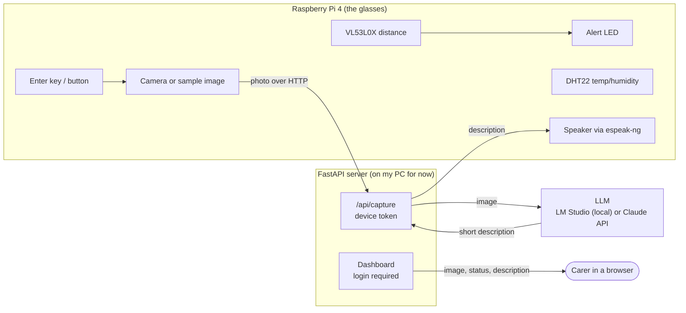
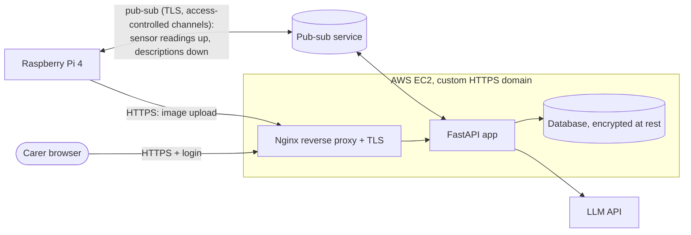

# Architecture

## Now (checkpoint prototype)

1. The user presses capture on the Pi. The Pi takes a photo, or uses a saved one until the camera arrives.
2. The Pi uploads the photo to the server with a secret device token.
3. The server sends the image to the LLM. The dashboard shows "Sending to LLM..." and then "LLM responding...".
4. The description comes back. The dashboard shows it, and the Pi reads it out loud.

The LLM API key lives only on the server, never on the Pi.

## Final target (what the brief asks for)

Still to do for the final submission:
- Pub-sub for sensor readings (distance, temperature, humidity) and for sending descriptions back to the Pi
- A database for captures, descriptions and readings, with password hashing and encryption at rest
- Deployment to AWS behind Nginx on a custom HTTPS domain, without default server configs
- A Fritzing sketch, the screencast, and AI_Chat_Log.md
